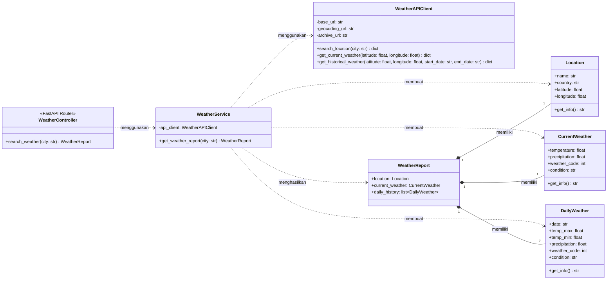
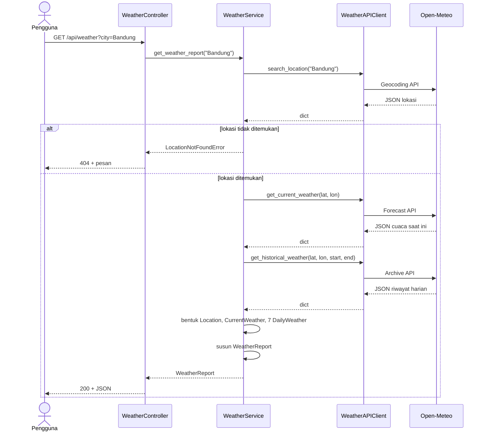

# Weather Search — OOP, Relasi, Cara Kerja, dan Teknologi

> [!info] Cakupan
> Catatan ini memakai **class diagram versi baru** (Bagian 9 `REQUIREMENTS.md`): `WeatherAPIClient` punya `archive_url` serta dua method terpisah, `get_current_weather` dan `get_historical_weather`. Gambar PNG lama (satu method `get_weather_data`) sudah usang.

---

## 1. Gambaran Besar

Weather Search adalah backend kecil yang menjawab satu pertanyaan: *"bagaimana cuaca di kota X, sekarang dan tujuh hari terakhir?"*

Bayangkan **dapur restoran**:

| Peran di dapur | Padanan di kode |
|---|---|
| Pelayan menerima pesanan | `WeatherController` |
| Kepala koki mengatur urutan masak | `WeatherService` |
| Pembelian bahan di pasar | `WeatherAPIClient` |
| Kotak kemasan berstandar | `Location`, `CurrentWeather`, `DailyWeather` |
| Nampan hidangan lengkap | `WeatherReport` |

Pelayan tidak pernah ke pasar, dan koki tidak melayani tamu. Pemisahan inilah inti rancangannya.

---

## 2. Class Diagram (Versi Baru)



### Cara membaca notasi

- Kotak dibagi tiga: **nama**, **atribut**, **method**.
- `+` = public, `-` = private. Di Python ini hanya konvensi (`_nama`), tidak ditegakkan interpreter.
- `..>` (putus-putus, panah terbuka) = **dependency**: "A memakai B".
- `*--` (berlian hitam) = **composition**: "A terdiri dari B".
- `"1"` dan `"7"` = **multiplicity**, jumlah objek pada sisi relasi.

---

## 3. Penerapan OOP

### 3.1 Encapsulation: data dan aturannya dibungkus bersama

Model (`Location`, `CurrentWeather`, `DailyWeather`) membungkus data dan validasinya. Dengan Pydantic `BaseModel`, objek yang tipenya salah tidak akan pernah terbentuk. `WeatherAPIClient` menyembunyikan URL dan detail HTTP sebagai atribut private.

### 3.2 Abstraction: menyembunyikan yang tidak perlu diketahui

Controller tidak tahu endpoint Open-Meteo, parameter query, atau bentuk JSON mentahnya. Ia cukup berkata *"beri aku laporan cuaca untuk kota ini"*. Service juga tidak tahu cara HTTP bekerja, karena itu urusan client.

### 3.3 Composition: relasi "has-a" yang kuat

`WeatherReport` **terdiri dari** satu `Location`, satu `CurrentWeather`, dan tujuh `DailyWeather`. Tanpa laporan, ketiga objek itu tidak punya konteks, sehingga siklus hidupnya mengikuti laporan. Itulah alasan berlian hitam dipakai, bukan berlian kosong (aggregation).

### 3.4 Dependency dan Dependency Injection

`WeatherService` bergantung pada `WeatherAPIClient`, tetapi **tidak membuatnya sendiri**. Objek client diberikan lewat constructor:

```python
class WeatherService:
    def __init__(self, api_client: WeatherAPIClient) -> None:
        self._api_client = api_client
```

Efeknya: saat pengujian, client asli bisa diganti *fake client* tanpa menyentuh internet.

### 3.5 Separation of Concerns dan Single Responsibility

Setiap class punya **satu alasan untuk berubah**:

| Class | Berubah jika... |
|---|---|
| `WeatherController` | bentuk endpoint atau format respons HTTP berubah |
| `WeatherService` | alur bisnis berubah (misalnya riwayat jadi 14 hari) |
| `WeatherAPIClient` | penyedia API atau parameter request berubah |
| Model | struktur data cuaca berubah |

### 3.6 Inheritance dan Polymorphism: dipakai seperlunya

Rancangan ini **tidak membuat hierarki pewarisan sendiri**, dan itu keputusan yang sehat untuk ruang lingkup sekecil ini. Pewarisan yang ada hanya model yang mewarisi `pydantic.BaseModel`. Polimorfisme muncul secara tidak langsung lewat *duck typing*: `WeatherService` menerima objek apa pun yang punya method yang sama dengan `WeatherAPIClient`, termasuk *fake client* untuk tes.

> [!note] Pola yang dipakai
> *Layered Architecture* (pola arsitektur), *Service Layer* (pola desain arsitektural), dan *Dependency Injection* (teknik desain). Ketiganya bukan GoF Design Pattern. Singleton, Factory, Observer, dan Strategy sengaja tidak dipakai karena belum dibutuhkan.

---

## 4. Rincian Setiap Class

> [!info] Dasar dulu: class dan objek
> **Class** adalah cetakan atau resep. **Objek** adalah hasil cetakannya. Class `Location` hanya mendefinisikan "sebuah lokasi punya `name`, `country`, `latitude`, `longitude`". Sedangkan `Location(name="Bandung", country="Indonesia", ...)` adalah **satu lokasi nyata** yang dicetak dari resep itu.
> **Atribut** = data yang dibawa objek. **Method** = hal yang bisa dilakukan objek.
> Di Weather Search ada dua jenis class: **class pekerja** (`WeatherService`, `WeatherAPIClient`) yang melakukan sesuatu, dan **class data** (`Location`, `CurrentWeather`, `DailyWeather`, `WeatherReport`) yang hanya membawa informasi.

### 4.0 Peta cepat: siapa tahu apa

Cara terbaik memahami pembagian class adalah bertanya: *"siapa yang tahu tentang hal ini?"*

> [!tip] Istilah belum familiar?
> HTTP server, httpx, dan URL Open-Meteo dijelaskan dari nol di [[#11. Lampiran Dasar Jaringan dan HTTP]].

| Class | Urusan HTTP server (FastAPI) | Urusan jaringan (httpx, URL Open-Meteo) | Isi JSON mentah Open-Meteo | Aturan bisnis (7 hari, zona waktu) |
|---|---|---|---|---|
| `WeatherController` | **Ya** | Tidak | Tidak | Tidak |
| `WeatherService` | Tidak | Tidak | **Ya** (membaca dan menerjemahkan) | **Ya** |
| `WeatherAPIClient` | Tidak | **Ya** | Tidak (hanya meneruskan) | Tidak |
| Model data | Tidak | Tidak | Tidak | Sebagian (validasi tipe, tepat 7 hari) |

Jika suatu hari Open-Meteo diganti penyedia lain, yang berubah hanya `WeatherAPIClient` dan sedikit bagian Service. Controller dan frontend tidak tersentuh.

---

### 4.1 `WeatherController`: pelayan yang menerima pesanan

**Analogi:** pelayan restoran. Ia menyapa tamu, mencatat pesanan, menyerahkannya ke dapur, lalu mengantar hasilnya. Ia tidak memasak dan tidak ke pasar.

**Satu kalimat:** menerima request `GET /api/weather?city=...`, meneruskannya ke Service, lalu mengubah hasilnya (atau kegagalannya) menjadi respons HTTP.

**Masuk → Proses → Keluar**

| | Isi |
|---|---|
| **Masuk** | Parameter query `city`, misalnya `"Bandung"` |
| **Proses** | Validasi input, minta Service bekerja, tangkap error |
| **Keluar** | JSON `WeatherReport` (status 200), atau pesan error (404 / 502) |

**Yang dikerjakan, berurutan**

1. FastAPI mencocokkan URL dengan fungsi `search_weather`.
2. Parameter `city` divalidasi. `Query(..., min_length=2)` menolak input kosong atau satu huruf.
3. FastAPI menyediakan `WeatherService` lewat `Depends(get_weather_service)`. Controller tidak membuat Service sendiri; ia *menerima* dari FastAPI (inilah *dependency injection* versi FastAPI).
4. Controller memanggil `service.get_weather_report(city)`.
5. Hasil sukses dikembalikan; FastAPI mengubah objek Pydantic menjadi JSON.
6. Jika Service melempar error, Controller menerjemahkannya menjadi status HTTP yang sesuai:

| Error dari Service | Artinya | Status HTTP |
|---|---|---|
| `LocationNotFoundError` | Kota tidak dikenal | **404** Not Found |
| `WeatherAPIError` | Open-Meteo bermasalah atau tidak terjangkau | **502** Bad Gateway |

**Yang TIDAK dikerjakan:** tidak memanggil Open-Meteo, tidak menghitung tanggal, tidak membuat objek model. Kalau kamu menemukan `httpx` di file controller, ada yang salah tempat.

**Mengapa «FastAPI Router», bukan class?** Di FastAPI, endpoint cukup berupa fungsi yang didaftarkan ke `APIRouter`. Membungkusnya dalam class hanya menambah lapisan tanpa manfaat. Diagram memakai kotak class karena UML butuh bentuk untuk menggambar komponen ini.

---

### 4.2 `WeatherService`: kepala koki yang mengatur seluruh proses

**Analogi:** kepala koki. Ia tahu resep lengkap (urutan langkah), menyuruh bagian pembelian mengambil bahan, lalu menyajikan hidangan jadi. Ia tidak berbelanja sendiri.

**Satu kalimat:** mengatur proses dari "nama kota" sampai "laporan cuaca lengkap", dan menjadi satu-satunya tempat aturan bisnis hidup.

**Atribut**

| Atribut | Tipe | Penjelasan |
|---|---|---|
| `-api_client` | `WeatherAPIClient` | Alat untuk mengambil data. **Private** (`-`) karena hanya dipakai di dalam Service. Diterima dari luar lewat constructor, sehingga bisa diganti *fake* saat tes. |

**Method `get_weather_report(city: str) -> WeatherReport`**, enam tahap di dalamnya:

| Tahap | Apa yang dilakukan | Memanggil |
|---|---|---|
| 1. Cari lokasi | Minta client mencari kota; jika hasil kosong, lempar `LocationNotFoundError` | `search_location` |
| 2. Bentuk `Location` | Ambil hasil pertama, ubah `dict` menjadi objek `Location` | n/a |
| 3. Cuaca saat ini | Minta cuaca sekarang berdasarkan koordinat, ubah jadi `CurrentWeather`, isi `condition` dari `weather_code` | `get_current_weather` |
| 4. Hitung jendela tanggal | Tentukan "hari ini" **di zona waktu lokasi**, lalu `start = hari ini − 7`, `end = hari ini − 1` | n/a |
| 5. Riwayat | Minta data harian untuk rentang itu, ubah jadi tujuh `DailyWeather` | `get_historical_weather` |
| 6. Susun laporan | Gabungkan semuanya jadi `WeatherReport`; Pydantic menolak jika bukan tepat 7 hari | n/a |

**Mengapa Service yang menghitung tanggal, bukan Client?** Karena "tujuh hari sebelum hari ini" adalah **aturan bisnis**. Client hanya tahu "beri aku data dari tanggal A sampai B". Kalau besok aturannya jadi 14 hari, kamu hanya mengubah Service.

**Mengapa Service yang menerjemahkan `dict` jadi model?** Karena Service-lah yang tahu bentuk laporan akhir. Client sengaja dibuat "buta" terhadap model agar tetap sederhana dan bisa dipakai ulang.

**Yang TIDAK dikerjakan:** tidak membuka koneksi HTTP, tidak mengenal status code HTTP, tidak tahu FastAPI ada.

---

### 4.3 `WeatherAPIClient`: bagian pembelian yang ke pasar

**Analogi:** staf pembelian. Ia hafal alamat tiga toko (tiga API), tahu cara bertanya ke masing-masing, dan melapor jika toko tutup. Ia tidak peduli bahan itu akan jadi masakan apa.

**Satu kalimat:** satu-satunya class yang berbicara langsung dengan Open-Meteo. Semua urusan jaringan terkurung di sini.

**Atribut (semuanya private)**

| Atribut | Isi | Dipakai oleh |
|---|---|---|
| `-base_url` | alamat Forecast API | `get_current_weather` |
| `-geocoding_url` | alamat Geocoding API | `search_location` |
| `-archive_url` | alamat Historical Weather API | `get_historical_weather` |

Ketiga URL dikumpulkan di satu tempat agar tidak tersebar di banyak file (NFR-07). Jika alamat berubah, kamu cukup mengedit satu baris.

**Tiga method**

| Method | Masuk | Parameter yang dikirim ke API | Keluar |
|---|---|---|---|
| `search_location(city)` | nama kota | `name`, `count=1`, `language=id` | `dict` berisi daftar `results` (nama, negara, lintang, bujur) |
| `get_current_weather(lat, lon)` | koordinat | `latitude`, `longitude`, `current=temperature_2m,precipitation,weather_code`, `timezone=auto` | `dict` berisi blok `current` dan `timezone` |
| `get_historical_weather(lat, lon, start_date, end_date)` | koordinat + rentang tanggal | `latitude`, `longitude`, `start_date`, `end_date`, `daily=...`, `timezone=auto` | `dict` berisi blok `daily` berupa daftar-daftar paralel (`time`, `temperature_2m_max`, ...) |

**Mengapa `get_historical_weather` butuh `start_date` dan `end_date`, sedangkan yang lain tidak?** Cuaca saat ini cukup "di mana". Riwayat butuh "di mana" **dan** "kapan". Itulah alasan versi lama (`get_weather_data` tunggal) diganti dua method.

**Penanganan kegagalan:** semua method melewati satu helper private `_get(url, params)` (tidak tergambar di diagram karena hanya detail internal). Helper ini menangani timeout dan error HTTP, lalu mengubahnya menjadi `WeatherAPIError` dengan pesan yang jelas. Jadi Service tidak perlu tahu `httpx` ada.

**Yang TIDAK dikerjakan:** tidak membuat `Location` atau `WeatherReport`, tidak menghitung tanggal, tidak mengisi `condition`.

---

### 4.4 `Location`: kartu identitas tempat

**Analogi:** kartu nama sebuah tempat.

| Atribut | Tipe | Contoh | Arti |
|---|---|---|---|
| `name` | `str` | `"Bandung"` | Nama lokasi hasil geocoding (bisa berbeda dari ketikan pengguna) |
| `country` | `str` | `"Indonesia"` | Negara lokasi |
| `latitude` | `float` | `-6.92` | Garis lintang; negatif berarti selatan khatulistiwa |
| `longitude` | `float` | `107.61` | Garis bujur; positif berarti timur Greenwich |

**Siapa yang membuatnya:** `WeatherService`, dari `results[0]` hasil geocoding.

**Untuk apa:** (1) ditampilkan ke pengguna (nama dan negara, FR-03), (2) koordinatnya dipakai untuk memanggil Forecast API dan Archive API.

**Method `get_info() -> str`:** menghasilkan ringkasan teks, misalnya `"Bandung, Indonesia"`. Opsional; tambahkan hanya jika memang dipakai.

---

### 4.5 `CurrentWeather`: foto kondisi cuaca saat ini

| Atribut | Tipe | Contoh | Arti |
|---|---|---|---|
| `temperature` | `float` | `27.4` | Suhu saat ini, °C |
| `precipitation` | `float` | `0.0` | Curah hujan saat ini, mm |
| `weather_code` | `int` | `3` | Kode kondisi cuaca standar WMO yang dipakai Open-Meteo |
| `condition` | `str` | `"Mendung"` | Teks hasil pemetaan dari `weather_code` |

**Mengapa menyimpan `weather_code` *dan* `condition`?** `weather_code` adalah data asli dari sumber (bagus untuk ikon atau pengujian). `condition` adalah terjemahan yang ramah manusia. Pemetaan harus **satu tempat dan konsisten** agar kode yang sama selalu menghasilkan teks yang sama.

Contoh sebagian pemetaan (kode WMO):

| `weather_code` | `condition` |
|---|---|
| 0 | Cerah |
| 1–3 | Cerah berawan hingga mendung |
| 45 | Berkabut |
| 51–55 | Gerimis |
| 61 / 63 / 65 | Hujan ringan / sedang / lebat |
| 80 | Hujan lokal ringan |
| 95 | Badai petir |

---

### 4.6 `DailyWeather`: satu baris catatan harian

Satu objek = **satu hari**. Karena riwayatnya tujuh hari, akan ada tujuh objek.

| Atribut | Tipe | Contoh | Arti |
|---|---|---|---|
| `date` | `str` (di kode: `datetime.date`) | `"2026-11-05"` | Tanggal data, dalam zona waktu lokasi |
| `temp_max` | `float` | `29.8` | Suhu tertinggi hari itu, °C |
| `temp_min` | `float` | `21.3` | Suhu terendah hari itu, °C |
| `precipitation` | `float` | `12.4` | **Total** hujan sepanjang hari, mm |
| `weather_code` | `int` | `61` | Kode kondisi cuaca harian |
| `condition` | `str` | `"Hujan ringan"` | Teks dari pemetaan kode |

**Beda dengan `CurrentWeather`:** `CurrentWeather` memotret *satu momen* (satu suhu). `DailyWeather` merangkum *satu hari penuh* (suhu maksimum, minimum, dan total hujan). Itu sebabnya atributnya berbeda.

**Mengapa ringkasan harian, bukan per jam?** Itu keputusan requirements (FR-07): lebih sederhana, lebih ringan, dan cukup untuk tujuan aplikasi.

---

### 4.7 `WeatherReport`: nampan hidangan lengkap

**Analogi:** nampan yang berisi tiga hal: kartu nama tempat, foto cuaca sekarang, dan tujuh catatan harian.

| Atribut | Tipe | Isi |
|---|---|---|
| `location` | `Location` | Satu objek |
| `current_weather` | `CurrentWeather` | Satu objek |
| `daily_history` | `list[DailyWeather]` | **Tepat tujuh** objek, urut dari tanggal terlama |

Class ini **tidak punya method**. Ia murni wadah, objek hasil yang dikembalikan Service. Karena Controller mendeklarasikan `response_model=WeatherReport`, FastAPI mengubahnya otomatis menjadi JSON seperti ini:

```json
{
  "location": { "name": "Bandung", "country": "Indonesia", "latitude": -6.92, "longitude": 107.61 },
  "current_weather": { "temperature": 27.4, "precipitation": 0.0, "weather_code": 3, "condition": "Mendung" },
  "daily_history": [
    { "date": "2026-11-03", "temp_max": 29.1, "temp_min": 21.0, "precipitation": 3.2,
      "weather_code": 61, "condition": "Hujan ringan" }
    // ... enam objek lagi, sampai 2026-11-09
  ]
}
```

*(Angka di atas ilustrasi, bukan data asli.)*

**Aturan pentingnya:** jika jumlah hari bukan tujuh, objek **tidak jadi dibuat**. Lebih baik error jelas daripada laporan yang kelihatan lengkap tetapi sebenarnya bolong.

---

## 5. Relasi Antarclass

### 5.1 Dependency (rantai pemanggilan)

```
WeatherController ..> WeatherService ..> WeatherAPIClient
```

Setiap lapisan hanya mengenal lapisan tepat di bawahnya. Controller tidak boleh memanggil client langsung.

| Relasi | Label | Arti |
|---|---|---|
| Controller → Service | menggunakan | meminta laporan |
| Service → APIClient | menggunakan | mengambil data eksternal |
| Service → Location, CurrentWeather, DailyWeather | membuat | menerjemahkan `dict` mentah jadi objek bertipe |
| Service → WeatherReport | menghasilkan | keluaran akhir |

### 5.2 Composition dan multiplicity

```
WeatherReport "1" *-- "1" Location
WeatherReport "1" *-- "1" CurrentWeather
WeatherReport "1" *-- "7" DailyWeather
```

Angka **7** adalah aturan bisnis yang tertanam di diagram: laporan lengkap harus berisi tepat tujuh ringkasan harian. Jika data historis gagal diambil, sistem mengembalikan **error**, bukan laporan berisi data palsu atau kurang dari tujuh hari.

---

## 6. Cara Kerja (Runtime)

### 6.1 Telusur satu permintaan: contoh nyata, "Bandung"

Mari ikuti satu permintaan dari awal sampai akhir, lengkap dengan **bentuk data di setiap langkah**. Pegang satu pertanyaan: *"data ini sekarang berada di tangan siapa, dan bentuknya apa?"*

*(Angka dan tanggal adalah ilustrasi. Anggap hari ini 10 November 2026 di Bandung.)*

> [!tip] Istilah "request", "status code", dan "respons HTTP"
> Dijelaskan di [[#11. Lampiran Dasar Jaringan dan HTTP]].

**Langkah 1. Pengguna mengetik "Bandung" di frontend.**
Frontend memanggil:
```
GET /api/weather?city=Bandung
```

**Langkah 2. FastAPI menerima dan mengarahkan.**
FastAPI mencocokkan URL dengan fungsi `search_weather`, memeriksa `city` (panjang minimal 2, lolos), lalu menyediakan objek `WeatherService` lewat `Depends`.
*Data: string `"Bandung"` di tangan **Controller**.*

**Langkah 3. Controller menyerahkan ke Service.**
```python
service.get_weather_report("Bandung")
```
*Data: string `"Bandung"` berpindah ke **Service**.*

**Langkah 4. Service meminta Client mencari lokasi.**
Client mengirim request HTTP ke Geocoding API dan menerima JSON, yang dibaca Python sebagai `dict`:
```python
{"results": [{"name": "Bandung", "country": "Indonesia",
              "latitude": -6.92, "longitude": 107.61, ...}]}
```
*Data: `dict` mentah, kembali ke **Service**.*

**Langkah 5. Service mengubah `dict` menjadi objek `Location`.**
Jika `results` kosong, di sinilah `LocationNotFoundError` dilempar. Jika ada:
```python
Location(name="Bandung", country="Indonesia", latitude=-6.92, longitude=107.61)
```
*Data: objek bertipe, hasil terjemahan Service.*

**Langkah 6. Service meminta cuaca saat ini.**
Client memanggil Forecast API memakai koordinat dari `Location`, lalu mengembalikan:
```python
{"timezone": "Asia/Jakarta",
 "current": {"temperature_2m": 27.4, "precipitation": 0.0, "weather_code": 3}}
```
Service menerjemahkannya menjadi `CurrentWeather(temperature=27.4, precipitation=0.0, weather_code=3, condition="Mendung")`. Teks "Mendung" datang dari pemetaan kode 3.

**Langkah 7. Service menghitung jendela tanggal.**
Zona waktu lokasi diambil dari langkah 6 (`"Asia/Jakarta"`):
```
hari ini = 2026-11-10
start    = hari ini − 7 hari = 2026-11-03
end      = hari ini − 1 hari = 2026-11-09
```
Hari ini sengaja tidak masuk riwayat, sesuai aturan 5.2.

**Langkah 8. Service meminta riwayat.**
Client memanggil Archive API dengan rentang itu. Perhatikan bentuk balikannya: **daftar-daftar paralel**, bukan daftar objek.
```python
{"daily": {
   "time":               ["2026-11-03", "2026-11-04", ... , "2026-11-09"],
   "temperature_2m_max": [29.1, 30.0, ...],
   "temperature_2m_min": [21.0, 21.5, ...],
   "precipitation_sum":  [3.2, 0.0, ...],
   "weather_code":       [61, 3, ...]}}
```
Elemen ke-*i* di setiap daftar milik hari yang sama. Service menyatukannya dengan `zip(...)` lalu membuat satu `DailyWeather` per hari, sehingga hasilnya tujuh objek.

**Langkah 9. Service menyusun `WeatherReport`.**
```python
WeatherReport(location=..., current_weather=..., daily_history=[tujuh objek])
```
Pydantic memeriksa: tipe data benar? Jumlah hari tepat tujuh? Jika ada yang salah, objek tidak terbentuk.

**Langkah 10. Controller mengembalikan hasilnya.**
Service menyerahkan `WeatherReport` ke Controller, FastAPI mengubahnya menjadi JSON, dan frontend menerima status **200**. Frontend lalu menampilkan `CurrentWeatherCard` dan `DailyWeatherList`.

#### Jika ada yang gagal

| Titik gagal | Penyebab contoh | Siapa yang menangkap | Hasil ke pengguna |
|---|---|---|---|
| Langkah 2 | `city` kosong atau satu huruf | FastAPI (validasi `Query`) | 422 |
| Langkah 4–5 | Kota "zzzzz" tidak ada | Service melempar `LocationNotFoundError`, Controller menangkap | **404** + pesan lokasi tidak ditemukan |
| Langkah 4, 6, atau 8 | Timeout, atau Open-Meteo down | Client melempar `WeatherAPIError`, Controller menangkap | **502** + pesan layanan bermasalah |
| Langkah 8–9 | Archive hanya mengembalikan 6 hari | Pydantic `ValidationError` di langkah 9 | Perlu ditangani (lihat catatan) |

> [!warning] Celah pada kerangka kode
> Pada kerangka kode di 6.4, `ValidationError` dari Pydantic belum ditangkap. Jika terjadi, pengguna menerima error 500 yang tidak informatif. Sebaiknya Service menangkapnya dan melemparkan ulang sebagai `WeatherAPIError` ("data cuaca dari penyedia tidak lengkap"), sehingga pengguna mendapat 502 yang jelas.

#### Siapa memegang data apa

```
string "Bandung"      →  Controller → Service → Client
JSON → dict mentah    →  Client → Service          (Client berhenti di sini)
objek model bertipe   →  dibuat Service
WeatherReport         →  Service → Controller → FastAPI → JSON → frontend
```

Perhatikan pola pentingnya: **data mentah tidak pernah naik melewati Service**, dan **objek model tidak pernah turun ke Client**. Service adalah penerjemah di tengah.

### 6.2 Sequence diagram



### 6.3 Aturan tanggal riwayat

Riwayat = **tujuh hari kalender sebelum hari ini**, hari ini tidak dihitung. Contoh: pencarian pada 9 November menghasilkan 2–8 November.

Batas "hari ini" harus mengikuti **zona waktu lokasi** (`timezone=auto`), bukan zona waktu server. Kalau tidak, pencarian untuk kota yang sudah berganti hari akan menggeser jendela tujuh harinya.

> [!warning] Perlu diverifikasi sebelum Bagian 5.2 dikunci
> Archive API berbasis data reanalysis, dan sejauh yang saya ketahui datanya punya jeda beberapa hari dari hari ini. Artinya "kemarin" mungkin belum tersedia. Cek dokumentasi Open-Meteo. Alternatifnya, Forecast API punya parameter `past_days` untuk data beberapa hari ke belakang.

### 6.4 Kerangka kode

> [!tip] Kerangka, bukan implementasi final
> Cukup untuk memperlihatkan bagaimana diagram menjadi kode. `LocationNotFoundError`, `WeatherAPIError`, dan `weather_code_to_text` adalah **usulan tambahan** yang belum ada di `REQUIREMENTS.md`.

**Model (`models/`)**

```python
import datetime as dt
from pydantic import BaseModel, Field


class Location(BaseModel):
    name: str
    country: str
    latitude: float
    longitude: float


class CurrentWeather(BaseModel):
    temperature: float
    precipitation: float
    weather_code: int
    condition: str


class DailyWeather(BaseModel):
    date: dt.date  # tipe date asli memudahkan aritmetika tanggal; Pydantic menyerialisasinya ke string ISO di JSON
    temp_max: float
    temp_min: float
    precipitation: float
    weather_code: int
    condition: str


class WeatherReport(BaseModel):
    location: Location
    current_weather: CurrentWeather
    # min_length = max_length = 7 menjadikan multiplicity "7" aturan yang benar-benar ditegakkan,
    # bukan sekadar gambar di diagram
    daily_history: list[DailyWeather] = Field(min_length=7, max_length=7)
```

**Client (`clients/weather_api_client.py`)**

```python
import httpx

from exceptions import WeatherAPIError


class WeatherAPIClient:
    def __init__(self, timeout: float = 10.0) -> None:
        # Semua URL dikumpulkan di satu tempat (NFR-07), tidak tersebar di banyak file
        self._base_url = "https://api.open-meteo.com/v1/forecast"
        self._geocoding_url = "https://geocoding-api.open-meteo.com/v1/search"
        self._archive_url = "https://archive-api.open-meteo.com/v1/archive"
        # Satu Client dipakai ulang agar koneksi HTTP tidak dibuka-tutup tiap request
        self._http = httpx.Client(timeout=timeout)

    def _get(self, url: str, params: dict) -> dict:
        # Seluruh penanganan error HTTP dipusatkan di sini supaya Service tidak perlu tahu httpx
        try:
            response = self._http.get(url, params=params)
            response.raise_for_status()
            return response.json()
        except httpx.HTTPError as exc:
            raise WeatherAPIError("Layanan cuaca tidak dapat dihubungi.") from exc

    def search_location(self, city: str) -> dict:
        return self._get(self._geocoding_url, {"name": city, "count": 1, "language": "id"})

    def get_current_weather(self, latitude: float, longitude: float) -> dict:
        return self._get(self._base_url, {
            "latitude": latitude,
            "longitude": longitude,
            "current": "temperature_2m,precipitation,weather_code",
            "timezone": "auto",  # agar tanggal mengikuti zona waktu lokasi
        })

    def get_historical_weather(
        self, latitude: float, longitude: float, start_date: str, end_date: str
    ) -> dict:
        return self._get(self._archive_url, {
            "latitude": latitude,
            "longitude": longitude,
            "start_date": start_date,
            "end_date": end_date,
            "daily": "temperature_2m_max,temperature_2m_min,precipitation_sum,weather_code",
            "timezone": "auto",
        })
```

**Service (`services/weather_service.py`)**

```python
import datetime as dt
from zoneinfo import ZoneInfo

from clients.weather_api_client import WeatherAPIClient
from exceptions import LocationNotFoundError
from models import CurrentWeather, DailyWeather, Location, WeatherReport
from utils import weather_code_to_text  # pemetaan kode → teks dipusatkan agar konsisten


class WeatherService:
    def __init__(self, api_client: WeatherAPIClient) -> None:
        self._api_client = api_client  # disuntik dari luar: mudah diganti fake saat tes

    def get_weather_report(self, city: str) -> WeatherReport:
        results = self._api_client.search_location(city).get("results")
        if not results:
            raise LocationNotFoundError(city)  # jalur gagal yang eksplisit, bukan data default
        top = results[0]
        location = Location(
            name=top["name"], country=top["country"],
            latitude=top["latitude"], longitude=top["longitude"],
        )

        raw_now = self._api_client.get_current_weather(location.latitude, location.longitude)
        now = raw_now["current"]
        current = CurrentWeather(
            temperature=now["temperature_2m"],
            precipitation=now["precipitation"],
            weather_code=now["weather_code"],
            condition=weather_code_to_text(now["weather_code"]),
        )

        # "Hari ini" dihitung di zona waktu lokasi, bukan zona waktu server
        today = dt.datetime.now(ZoneInfo(raw_now["timezone"])).date()
        raw_hist = self._api_client.get_historical_weather(
            location.latitude, location.longitude,
            (today - dt.timedelta(days=7)).isoformat(),
            (today - dt.timedelta(days=1)).isoformat(),
        )
        d = raw_hist["daily"]
        history = [
            DailyWeather(
                date=day, temp_max=tmax, temp_min=tmin, precipitation=rain,
                weather_code=code, condition=weather_code_to_text(code),
            )
            for day, tmax, tmin, rain, code in zip(
                d["time"], d["temperature_2m_max"], d["temperature_2m_min"],
                d["precipitation_sum"], d["weather_code"],
            )
        ]

        # Jika jumlah hari bukan 7, Pydantic menolaknya; tidak ada laporan "setengah jadi"
        return WeatherReport(location=location, current_weather=current, daily_history=history)
```

**Controller (`controllers/weather_controller.py`)**

```python
from functools import lru_cache

from fastapi import APIRouter, Depends, HTTPException, Query

from clients.weather_api_client import WeatherAPIClient
from exceptions import LocationNotFoundError, WeatherAPIError
from models import WeatherReport
from services.weather_service import WeatherService

router = APIRouter(prefix="/api")


@lru_cache  # satu instance dipakai ulang; ini penyambungan DI, bukan pola Singleton
def get_weather_service() -> WeatherService:
    return WeatherService(WeatherAPIClient())


@router.get("/weather", response_model=WeatherReport)
def search_weather(
    city: str = Query(..., min_length=2),
    service: WeatherService = Depends(get_weather_service),
) -> WeatherReport:
    try:
        return service.get_weather_report(city)
    except LocationNotFoundError:
        raise HTTPException(status_code=404, detail="Lokasi tidak ditemukan.")
    except WeatherAPIError:
        raise HTTPException(status_code=502, detail="Layanan cuaca sedang bermasalah.")
```

**Contoh tes dengan fake client (manfaat DI)**

```python
class FakeClient:
    def search_location(self, city: str) -> dict:
        return {}  # simulasi "lokasi tidak ditemukan" tanpa internet


def test_lokasi_tidak_ditemukan():
    service = WeatherService(FakeClient())
    with pytest.raises(LocationNotFoundError):
        service.get_weather_report("zzzzz")
```

---

## 7. Teknologi dan Library

### 7.1 Backend

| Teknologi | Peran | Lapisan | Alasan |
|---|---|---|---|
| **Python** | Bahasa backend | semua | Sesuai NFR-01 dan ekosistem data yang matang |
| **FastAPI** | Framework REST API, routing, dan *dependency injection* (`Depends`) | Controller | Ringan, tipe-aware, dokumentasi OpenAPI otomatis di `/docs` |
| **Uvicorn** | Server ASGI yang menjalankan FastAPI | infrastruktur | Pasangan standar FastAPI, ringan di RAM |
| **HTTPX** | HTTP client ke Open-Meteo, dengan timeout dan penanganan error | API Client | API mirip `requests`, mendukung sync dan async |
| **Pydantic** | Validasi dan serialisasi model | Models | Sudah menjadi dependency FastAPI; menegakkan tipe dan multiplicity |
| **Pytest** | Pengujian Service dan Client | pengujian | Sederhana; cocok dengan *fake client* |
| **uv** | Manajer paket dan environment | tooling | Cepat dan hemat sumber daya |

Instalasi:

```bash
uv add fastapi uvicorn httpx
uv add --dev pytest
uv run uvicorn main:app --reload
```

> [!tip] Sync atau async?
> Kerangka kode di atas memakai `httpx.Client` dan fungsi `def` biasa, karena lebih mudah dipelajari (NFR-08). FastAPI menjalankan fungsi `def` di *threadpool*, jadi tetap aman. Beralih ke `httpx.AsyncClient` dan `async def` bisa dilakukan kemudian tanpa mengubah struktur lapisan.

### 7.2 Sumber data: Open-Meteo

| Layanan | Dipakai untuk | Dipanggil oleh | Contoh endpoint |
|---|---|---|---|
| Geocoding API | Nama kota → koordinat | `search_location` | `geocoding-api.open-meteo.com/v1/search` |
| Forecast API | Cuaca saat ini | `get_current_weather` | `api.open-meteo.com/v1/forecast` |
| Historical Weather (Archive) API | Ringkasan harian riwayat | `get_historical_weather` | `archive-api.open-meteo.com/v1/archive` |

Data historis berbasis **model cuaca**, bukan pengukuran langsung stasiun setempat. Aplikasi tidak boleh mengklaimnya sebagai pengukuran langsung.

### 7.3 Frontend (Bagian 16)

| Teknologi | Peran |
|---|---|
| **React + Vite** | Antarmuka; Vite memberi dev server dan build yang cepat |
| **`fetch`** | Memanggil `GET /api/weather?city={nama}` |
| **Tailwind CSS** | Styling berbasis utility class |
| **Penpot** (via MCP) | Desain visual sebelum implementasi |

Komponen: `WeatherApp` (state, loading, dan penyusunan laporan), `WeatherSearchForm`, `CurrentWeatherCard`, `DailyWeatherList`.

---

## 8. Struktur Folder dan Pemetaan Lapisan

```text
backend/
├── main.py                       ← membuat app FastAPI, memasang router
├── controllers/
│   └── weather_controller.py     ← lapisan Controller
├── services/
│   └── weather_service.py        ← lapisan Service
├── clients/
│   └── weather_api_client.py     ← lapisan API Client
└── models/
    ├── location.py
    ├── current_weather.py
    ├── daily_weather.py
    └── weather_report.py         ← lapisan Models
```

Arah dependensi selalu **ke bawah**: `controllers → services → clients`, sementara `models` dipakai bersama. Hindari import melingkar atau ke arah sebaliknya.

---

## 9. Catatan Desain dan Usulan Perbaikan

1. **Jalur gagal belum ada di diagram.** Tambahkan `LocationNotFoundError` dan `WeatherAPIError` (misalnya di `exceptions.py`). Service melempar, Controller menerjemahkan ke 404 dan 502.
2. **Pemetaan `weather_code → condition`** belum punya rumah. Satu modul `utils` atau tabel konstanta sudah cukup.
3. **`date: str` pada diagram** sebaiknya `datetime.date` di kode (lihat model di atas).
4. **`get_info()` pada tiga model bersifat opsional**, dan dokumen menyebutnya "jika diperlukan". Tambahkan hanya jika benar-benar dipakai.
5. **Client mengembalikan `dict` mentah.** Validasi Pydantic di perbatasan Service sudah menutup celah ini. Tangkap `pydantic.ValidationError` dan `KeyError` di Service, lalu lempar ulang sebagai `WeatherAPIError`, supaya respons API yang tidak lengkap menghasilkan 502 yang jelas, bukan error 500.
6. **Verifikasi jeda data Archive API** (lihat peringatan di Bagian 6.3) sebelum mengunci aturan "tujuh hari sebelum hari ini".

---

## 10. Ringkasan

Rancangan ini seperti **rantai estafet dengan satu gudang di ujungnya**. Controller menerima tongkat dari pengguna, Service membawanya dan memutuskan rutenya, Client mengambil barang dari gudang luar, dan model adalah kardus berstandar tempat hasilnya dikemas. Kekuatannya ada pada batas yang tegas: tiap class punya satu alasan untuk berubah, dependensi hanya mengalir ke bawah, dan aturan penting seperti "tepat tujuh hari" ditegakkan oleh kode, bukan hanya digambar. Pekerjaan yang tersisa adalah melengkapi jalur kegagalan dan memastikan sumber data historis benar-benar menyediakan jendela tujuh hari yang dijanjikan.

---

## 11. Lampiran Dasar Jaringan dan HTTP

> [!info] Kenapa ada lampiran ini
> Bagian 4 dan 6 memakai istilah *HTTP server*, *httpx*, *URL Open-Meteo*, dan *respons HTTP*. Keempatnya sebenarnya satu cerita: **cara dua program saling bicara lewat jaringan**.

### 11.1 Gambaran besar: aplikasimu memakai dua topi

```
 Browser / Frontend            Backend-mu (Weather Search)              Open-Meteo
 ┌──────────────┐  request   ┌───────────────────────────┐  request   ┌──────────────┐
 │   CLIENT     │ ─────────► │ SERVER  (Uvicorn+FastAPI) │            │              │
 │ (peminta)    │            │         ↓                 │            │   SERVER     │
 │              │ ◄───────── │ CLIENT  (httpx)           │ ─────────► │ (pemberi     │
 └──────────────┘  response  └───────────────────────────┘ ◄───────── │  data)       │
                                                           response   └──────────────┘
```

Backend-mu bersikap sebagai **server** terhadap frontend, tetapi sebagai **client** terhadap Open-Meteo. Seperti pelayan restoran: ia *penjual* bagi tamu, tetapi *pembeli* saat ke pasar.

---

### 11.2 Apa itu HTTP server?

**HTTP** adalah aturan percakapan antar program di internet: format kalimat permintaan dan format kalimat jawaban. **HTTP server** adalah program yang terus **mendengarkan** di sebuah alamat dan port (misalnya `localhost:8000`), menerima permintaan, menjalankan kode, lalu membalas.

**Analogi:** loket pelayanan. Loket buka terus; siapa pun yang datang dengan formulir yang benar akan dilayani dan mendapat jawaban.

Di proyekmu ada dua tokoh yang sering dikira satu:

| Tokoh | Peran | Analogi |
|---|---|---|
| **Uvicorn** | Server-nya: membuka port, menerima koneksi mentah, membaca teks HTTP | Gedung dan petugas pintu |
| **FastAPI** | Framework: memutuskan fungsi Python mana yang menangani URL tertentu | Resepsionis yang mengarahkan ke loket yang tepat |

Itulah sebabnya perintah menjalankannya adalah `uvicorn main:app`: "Uvicorn, layani aplikasi `app` dari `main.py`".

**Bentuk permintaan** yang diterima server (teks biasa, bukan sihir):

```
GET /api/weather?city=Bandung HTTP/1.1
Host: localhost:8000
```

Artinya: *"Tolong ambilkan (GET) sumber daya di jalur `/api/weather`, dengan keterangan `city=Bandung`."*

---

### 11.3 Apa itu httpx?

**httpx** adalah library Python untuk **mengirim** permintaan HTTP. Ia seperti **browser tanpa jendela**: bisa membuka URL dan membaca jawabannya, tetapi lewat kode.

```python
import httpx

# Mengirim GET ke Geocoding API, persis seperti mengetik URL di browser
response = httpx.get(
    "https://geocoding-api.open-meteo.com/v1/search",
    params={"name": "Bandung", "count": 1},  # httpx menyusun "?name=Bandung&count=1" otomatis
    timeout=10.0,                            # jangan menunggu selamanya jika server macet
)

response.status_code   # 200
response.json()        # JSON dari server → dict Python
```

| Istilah | Artinya |
|---|---|
| `params={...}` | Parameter di ujung URL (`?name=...`); httpx menyusun dan meng-encode-nya |
| `timeout` | Batas waktu menunggu; tanpanya, server yang macet bisa membuat aplikasimu menggantung |
| `raise_for_status()` | Melempar error jika status jawaban 4xx/5xx, supaya kegagalan tidak lolos diam-diam |
| `response.json()` | Mengubah teks JSON menjadi `dict` atau `list` Python |
| `httpx.Client()` | Sesi yang bisa dipakai ulang, sehingga koneksi tidak dibuka-tutup tiap request |

**Mengapa dikurung di `WeatherAPIClient`?** Semua kerumitan jaringan (timeout, error, koneksi putus) ada di satu tempat. Service cukup memanggil `search_location("Bandung")` tanpa tahu httpx ada.

---

### 11.4 Apa itu URL Open-Meteo?

**Open-Meteo** adalah layanan penyedia data cuaca yang bisa dipanggil program lain. Pintu yang dibuka untuk program disebut **API**, dan jawabannya berbentuk **JSON**.

> [!note] API key
> Sejauh yang saya ketahui, penggunaan non-komersial tidak mewajibkan API key, tetapi cek ketentuan terbarunya di situs resmi Open-Meteo.

**URL** adalah alamat pintu itu. Bedah satu contoh:

```
https://geocoding-api.open-meteo.com/v1/search?name=Bandung&count=1&language=id
└─┬──┘   └──────────────┬────────────┘└───┬───┘ └──────────────┬──────────────┘
scheme            host (server mana)    path (pintu mana)    query (pertanyaannya)
```

| Bagian | Arti |
|---|---|
| `https://` | Protokol; `s` berarti terenkripsi |
| `geocoding-api.open-meteo.com` | Alamat server |
| `/v1/search` | Jalur layanan: versi 1, fitur pencarian |
| `?name=Bandung&count=1&language=id` | Parameter: nama yang dicari, jumlah hasil, bahasa; dipisah `&` |

Tiga URL dasar yang dipakai (isi atribut `_base_url`, `_geocoding_url`, `_archive_url`):

| Atribut | URL dasar | Menjawab pertanyaan |
|---|---|---|
| `_geocoding_url` | `geocoding-api.open-meteo.com/v1/search` | "Koordinat kota ini di mana?" |
| `_base_url` | `api.open-meteo.com/v1/forecast` | "Bagaimana cuacanya sekarang di koordinat ini?" |
| `_archive_url` | `archive-api.open-meteo.com/v1/archive` | "Bagaimana cuacanya pada rentang tanggal ini?" |

> [!tip] Coba sendiri
> Tempel URL geocoding di atas ke browser. Kamu akan melihat JSON mentah yang persis sama dengan yang diterima `search_location`. Cara ini bagus untuk melihat bentuk data sebelum menulis kode.

---

### 11.5 Apa maksud "mengubah hasilnya menjadi respons HTTP"?

**Masalah dasarnya:** Service bekerja dalam bahasa **Python**. Ia mengembalikan objek `WeatherReport`, atau melempar error seperti `LocationNotFoundError`. Tetapi frontend (JavaScript di browser) tidak bisa menerima objek Python atau exception Python. Satu-satunya hal yang bisa dikirim lewat jaringan adalah **teks yang mengikuti format HTTP**.

**Respons HTTP** punya tiga bagian:

| Bagian | Fungsi | Contoh |
|---|---|---|
| **Status code** | Ringkasan hasil, dibaca frontend lebih dulu | `200`, `404`, `502` |
| **Headers** | Keterangan tentang isi | `content-type: application/json` |
| **Body** | Isi jawabannya | teks JSON |

**Tugas Controller adalah menerjemahkan dunia Python ke dunia HTTP:**

| Dari Service (Python) | Menjadi respons HTTP |
|---|---|
| Objek `WeatherReport` | Status **200** + body JSON laporan |
| `LocationNotFoundError` | Status **404** + `{"detail": "Lokasi tidak ditemukan."}` |
| `WeatherAPIError` | Status **502** + `{"detail": "Layanan cuaca sedang bermasalah."}` |

Dalam kode:

```python
try:
    return service.get_weather_report(city)   # sukses → FastAPI ubah objek jadi JSON, status 200
except LocationNotFoundError:
    # exception Python → status 404 yang bisa dipahami frontend
    raise HTTPException(status_code=404, detail="Lokasi tidak ditemukan.")
except WeatherAPIError:
    raise HTTPException(status_code=502, detail="Layanan cuaca sedang bermasalah.")
```

Satu respons sukses, di tingkat teks HTTP, tampak begini:

```
HTTP/1.1 200 OK
content-type: application/json

{"location": {"name": "Bandung", ...}, "current_weather": {...}, "daily_history": [...]}
```

**Mengapa status code penting?** Frontend memutuskan tampilannya dari angka itu: `200` berarti tampilkan kartu cuaca, `404` berarti tampilkan "kota tidak ditemukan", `502` berarti tampilkan "layanan bermasalah, coba lagi". Tanpa status code yang tepat, frontend harus menebak dari isi pesan.

**Mengapa Service tidak melakukannya sendiri?** Supaya Service tidak tahu apa pun soal HTTP. Akibatnya, Service bisa dipakai ulang dari skrip terminal, dari tes Pytest, atau dari framework lain tanpa diubah. Kata "404" tidak pernah muncul di dalamnya.

---

### 11.6 Sintesis

Keempat istilah tadi adalah sisi-sisi dari satu **perjalanan surat**. **URL** adalah alamat di amplop, **httpx** adalah kurir yang mengantarkan surat dari backend-mu ke Open-Meteo, dan **HTTP server** (Uvicorn + FastAPI) adalah kantor pos yang menerima surat dari frontend untuk backend-mu. Adapun "mengubah hasil menjadi respons HTTP" adalah tugas menyusun surat balasan dengan format baku: **stempel status** di depan (200/404/502), baru isi suratnya. Python tidak ikut terbang ke luar. Yang berangkat hanya teks, sehingga siapa pun, dengan bahasa apa pun, bisa membacanya.

---

*Terkait:* [[REQUIREMENTS]]
